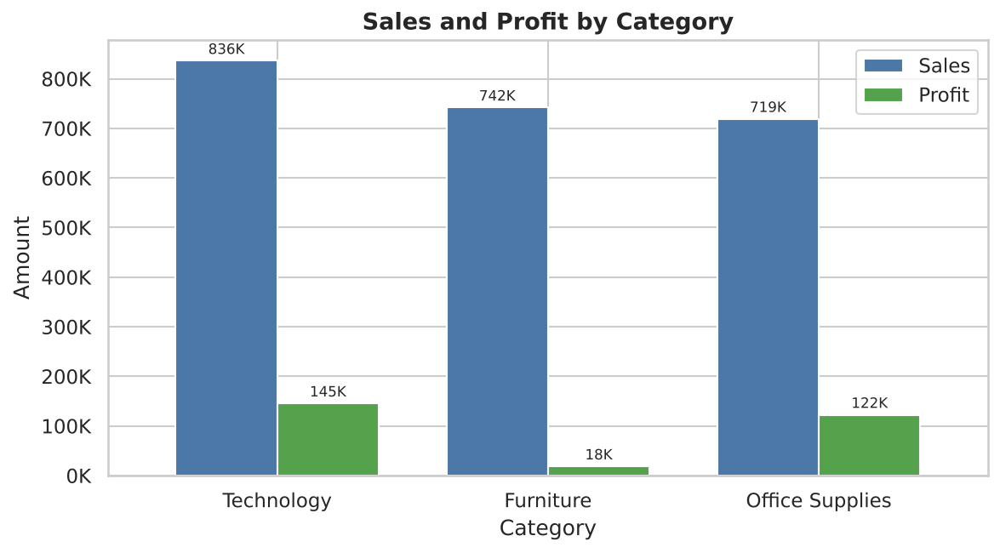
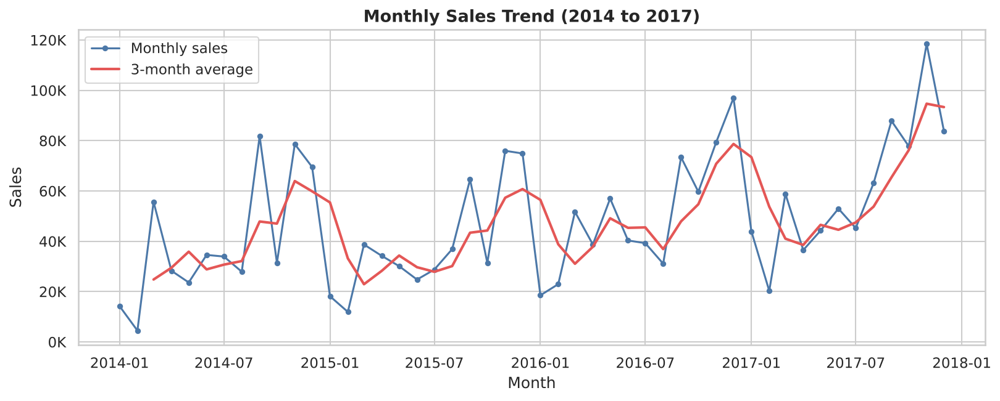
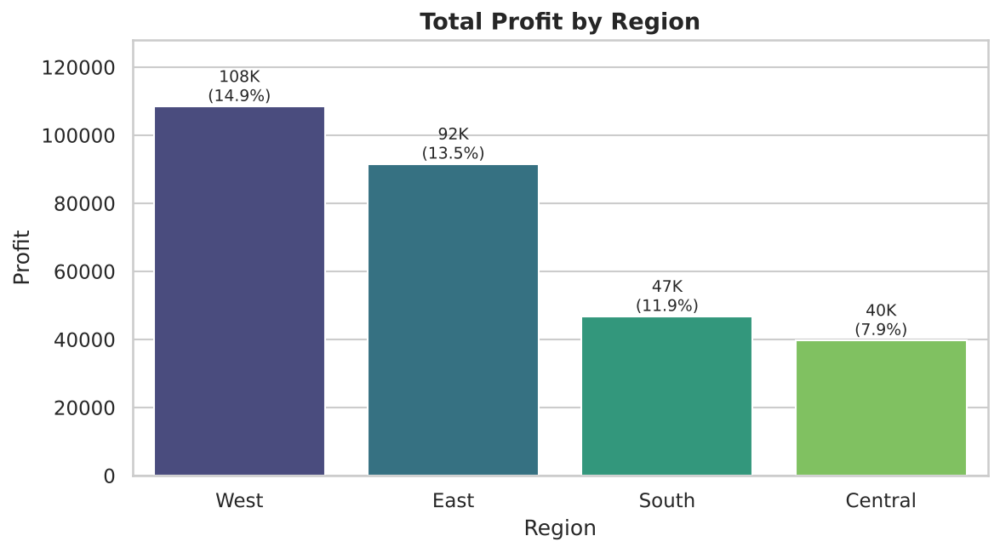
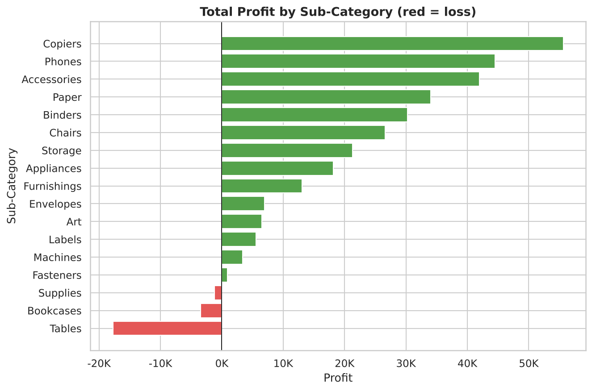
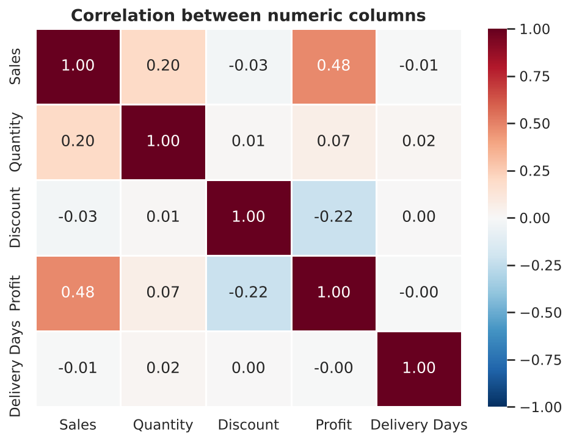
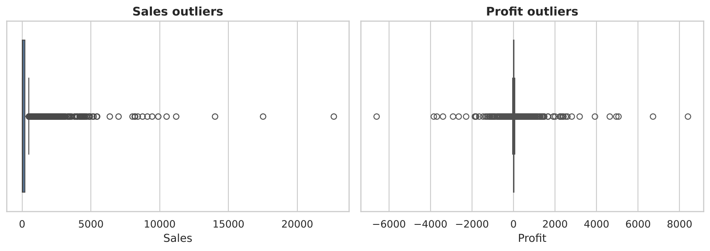
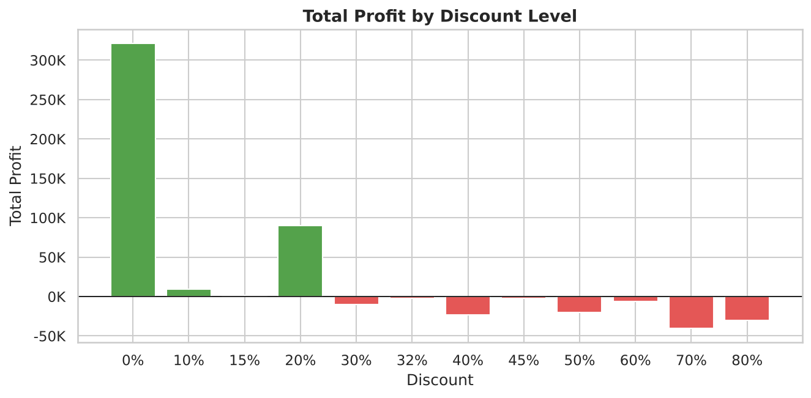
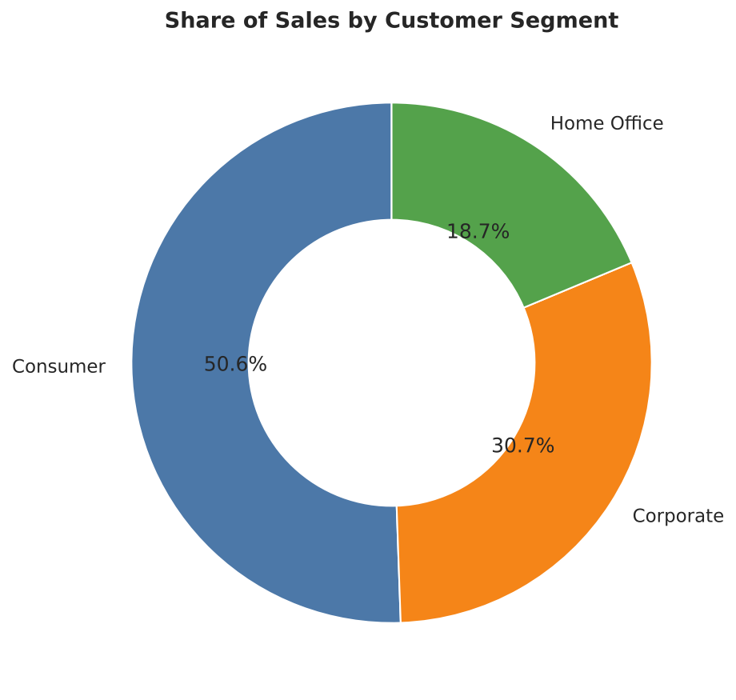
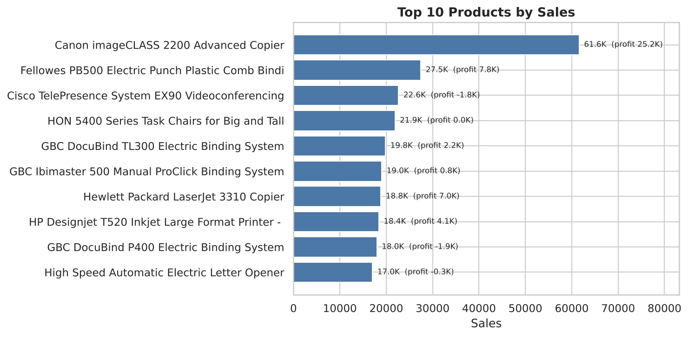
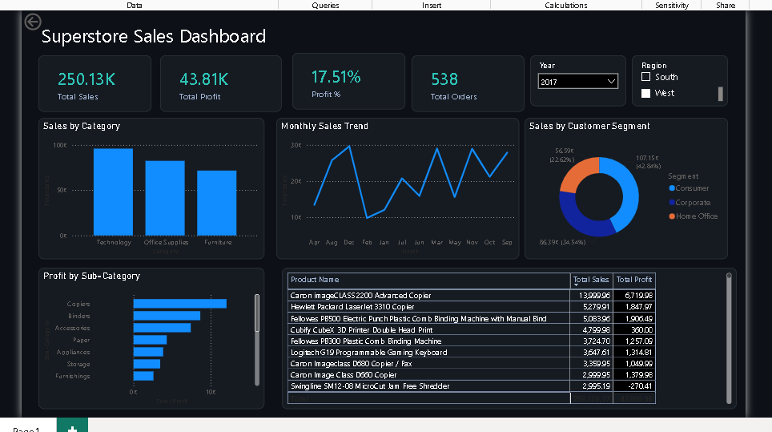

# Superstore Sales Analysis

**An end-to-end data analytics project: Python (pandas), EDA, visualisations and a Power BI dashboard**

Author: Gajanan Raje | MGM's College of Computer Science & IT, Nanded
Program: AICTE | IBM SkillsBuild Data Analytics with AI Internship 2026, Week 6 (Final Project)

---

## 1. Project Overview
This project analyses four years (2014 to 2017) of Superstore retail orders. It covers data cleaning, exploratory data analysis (EDA), visualisation and an interactive Power BI dashboard, and ends with business insights and recommendations.

## 2. Problem Statement
The store makes **2.30M in sales** but only **12.47% profit margin**. The goal is to find out:
- Which categories, products and regions make money and which lose it?
- How do discounts affect profit?
- How are sales changing over time?
- What should the business do to improve profit?

## 3. Dataset Description
Three related tables (joined on `Product ID` and `Customer ID`):

| File | Rows | Columns |
|---|---|---|
| `Orders_fixed.csv` | 9,994 | Row ID, Order ID, Order Date, Ship Date, Ship Mode, Customer ID, Country, City, State, Postal Code, Region, Product ID, Sales, Quantity, Discount, Profit |
| `Products.csv` | 1,862 | Product ID, Category, Sub-Category, Product Name |
| `Customers.csv` | 793 | Customer ID, Customer Name, Segment |

- Period: 3 Jan 2014 to 30 Dec 2017
- 5,009 unique orders, 793 customers, 1,862 products, 4 regions
- Cleaned and merged file: `Superstore_cleaned.csv` (28 columns)

## 4. Tools Used
Python 3, pandas, NumPy, Matplotlib, Seaborn, Jupyter Notebook, Power BI Desktop, Git and GitHub.

## 5. Data Cleaning Process
| Check | Result | Action |
|---|---|---|
| Missing values | 0 in all 3 tables | None needed |
| Duplicate rows / IDs | 0 | None needed |
| Orders without a product or customer | 0 | Tables joined safely (many-to-one validated) |
| Dates stored as text | Order Date, Ship Date | Converted to datetime |
| Corrupted characters in 6 customer names (e.g. "Franz�sisch") | 6 names | Garbled characters removed |
| Invalid values (negative sales, quantity <= 0, discount outside 0 to 1, ship before order) | 0 | None needed |
| New columns | | Year, Month, YearMonth, Delivery Days, Profit Margin %, Loss Making |

## 6. Exploratory Data Analysis (EDA)
- **Totals:** Sales 2,297,201 | Profit 286,397 | Margin 12.47% | 5,009 orders.
- **Correlation:** Profit has a moderate positive link with Sales (0.48) and a negative link with Discount (-0.22). Delivery time has no link with profit.
- **Outliers (IQR):** 11.7% of lines are Sales outliers and 18.8% are Profit outliers. These are real big orders and heavy-discount losses, not errors, so they were **kept**.
- **Loss-making lines:** 18.7% of all order lines lose money.
- **Trend:** Sales grew from 484K (2014) to 733K (2017). Growth was +29.5% in 2016 and +20.4% in 2017.

Full code and outputs: [`Superstore_Sales_Analysis.ipynb`](Superstore_Sales_Analysis.ipynb)

## 7. Visualizations
| | |
|---|---|
|  |  |
|  |  |
|  |  |
|  |  |



## 8. Power BI Dashboard
File: `Week5_PowerBI_Gajanan__Raje.pbix` (PDF export: `Week5_PowerBI_Gajanan.pdf`)

| Element | Details |
|---|---|
| KPI cards | Total Sales 2.30M, Total Profit 286.40K, Profit % 12.47%, Total Orders 5.009K |
| Visuals | Sales by Category, Monthly Sales Trend, Sales by Customer Segment, Profit by Sub-Category, Product table |
| Slicers | Year, Region |




## 9. Key Insights
1. **Technology earns the most, Furniture earns almost nothing.** Technology: 836K sales and 145K profit (17.4% margin). Furniture: 742K sales but only 18K profit (2.5% margin). Office Supplies: 719K sales and 122K profit (17.0%).
2. **Three sub-categories lose money:** Tables (-17.7K), Bookcases (-3.5K) and Supplies (-1.2K). The best are Copiers (55.6K profit, 37% margin), Phones (44.5K) and Accessories (41.9K).
3. **Discounts above 20% destroy profit.** The 1,393 lines (13.9%) with more than 20% discount lost **135K** in total, while the lines with 20% or less discount earned **422K**. Lines with 70% and 80% discount have average margins of -80% and -183%.
4. **Central region and a few states under-perform.** Central has 501K sales (more than South) but the lowest margin (7.9%, versus 14.9% in West). Texas (-25.7K), Ohio (-17.0K), Pennsylvania (-15.6K) and Illinois (-12.6K) are the biggest loss-making states, while California (76.4K) and New York (74.0K) lead.
5. **Sales are growing and seasonal.** Sales rose 51% from 2014 to 2017. November (352K), December (325K) and September (308K) are the strongest months. Consumers bring 50.6% of sales, Corporate 30.7% and Home Office 18.7%.

## 10. Business Recommendations
1. **Cap discounts at 20%** (and approve anything higher manually), especially for Furniture. Removing the loss from deep discounts could add up to about 135K of profit.
2. **Fix or drop the loss-making products:** review prices and supplier cost for Tables and Bookcases, and promote the high-margin lines (Copiers, Phones, Accessories, Paper, Labels).
3. *(Bonus)* **Stock and market ahead of Sep to Dec** and investigate the Central region and the states Texas, Ohio, Pennsylvania and Illinois (discount levels and shipping cost).

## 11. Conclusion
The store is growing, but profit is leaking through heavy discounts and weak Furniture sub-categories. Controlling discounts and focusing on high-margin Technology and Office Supplies products is the fastest way to raise the 12.47% margin.

## 12. Repository Structure
```
Superstore-Sales-Analysis/
├── Superstore_Sales_Analysis.ipynb   # cleaning, EDA, charts
├── Superstore_cleaned.csv            # cleaned and merged data
├── Orders_fixed.csv, Products.csv, Customers.csv   # raw data
├── Week5_PowerBI_Gajanan__Raje.pbix  # Power BI dashboard
├── charts/                           # chart images
├── Superstore_Sales_Presentation.pptx
├── requirements.txt
└── README.md
```
**Run it:** `pip install -r requirements.txt`, then open the notebook with `jupyter notebook`.
